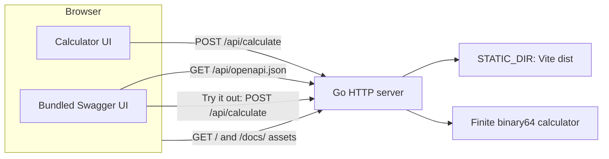
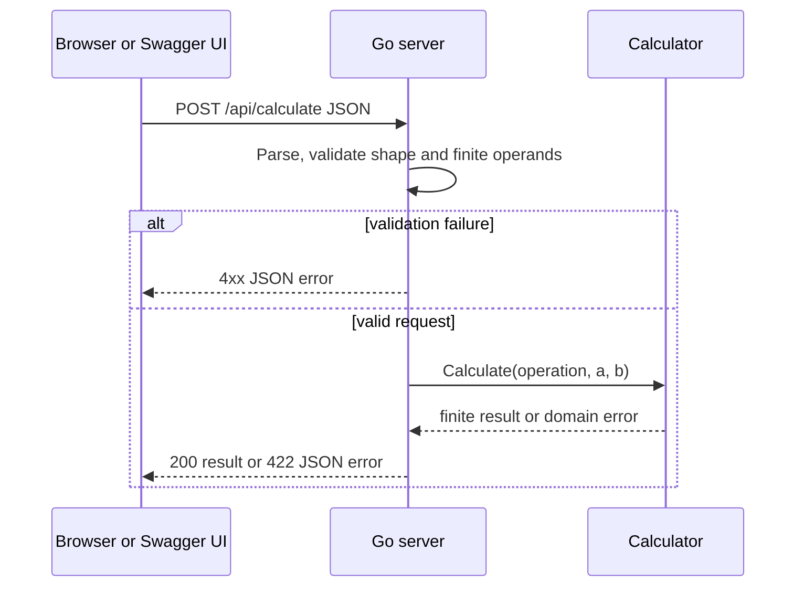

# Architecture

The production application is one stateless Go process. It serves compiled
frontend files from `STATIC_DIR`, the calculator API, OpenAPI JSON, and health
checks on one same-origin port. Vite's development proxy is only for local UI
development.

There is no database, authentication, queue, cache, or background worker:
calculation is synchronous, deterministic for the documented binary64 inputs,
and has no side effects. [DECISIONS.md](DECISIONS.md) explains the measured
scope decision; [SPEC.md](SPEC.md) and [NUMERIC-VALIDATION.md](NUMERIC-VALIDATION.md)
define the behavior.
